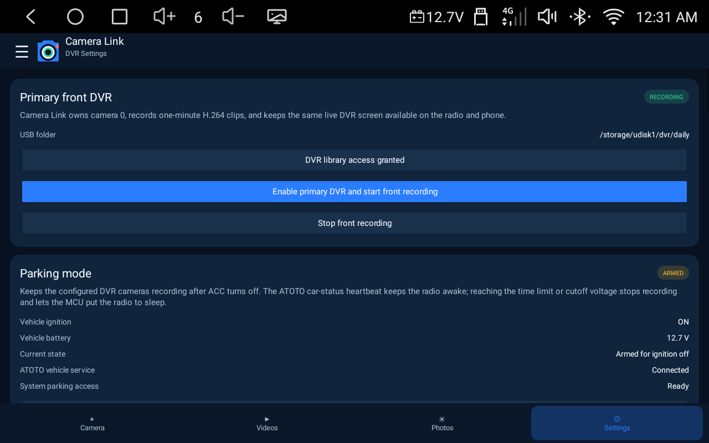
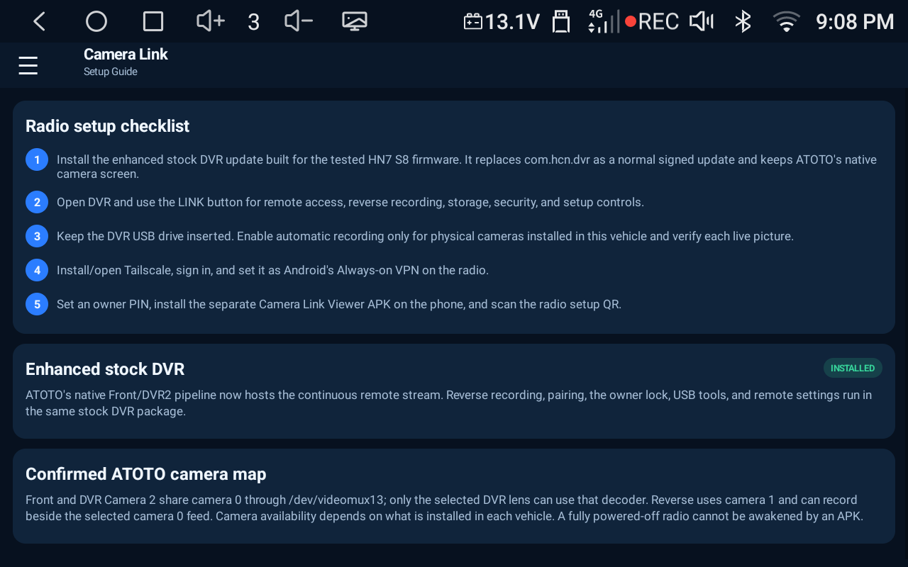
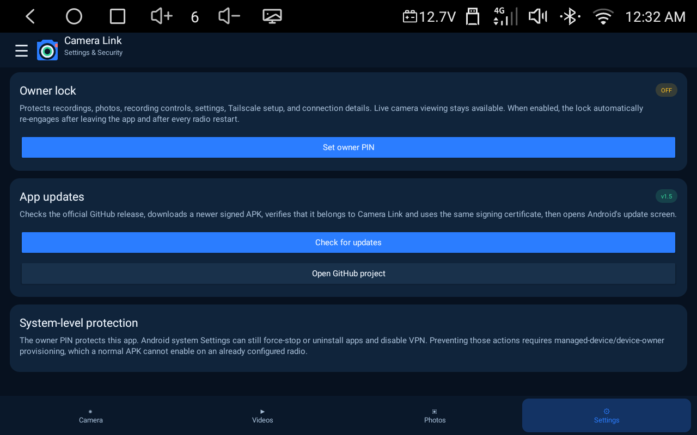

# ATOTO Remote Dual DVR for S8

An independent DVR replacement and remote camera viewer for compatible ATOTO S8 radios. One APK can run in **Radio mode** on the head unit or **Phone mode** on an Android phone. The radio records directly to its DVR USB drive; the phone reaches it through a private Tailscale connection.

[Download the latest APK](https://github.com/mfoster978/ATOTO-Remote-Dual-DVR-for-S8/releases/latest) · [Read the setup guide](#radio-installation) · [See tested hardware](#tested-hardware)

> This is a community project. It is not made, supported, or endorsed by ATOTO or Tailscale.

## Why this app is useful

**The main feature is live access to the vehicle's cameras from an Android phone or tablet, from anywhere the radio and phone have Internet access.** When Camera Link parking mode keeps the S8 powered after the ignition is turned off, the same private Tailscale connection remains available for live Front DVR, DVR Camera 2, backup/reverse-camera, or split-screen viewing. The radio must still have power and Internet access; no app can contact a head unit after the MCU has fully shut it down or after the configured parking-time or battery-voltage cutoff is reached.

ATOTO's own [parking-recording feature comparison](https://www.atotodirect.com/blogs/guides/what-is-parking-recording-how-atoto-smart-parking-monitoring-helps-protect-your-vehicle-while-parked) lists **Mobile App Remote Viewing** as supported on X10 and not supported on S8 Gen4. ATOTO separately promotes [X10 D-DVR remote wake and live viewing through SSHub](https://www.atotodirect.com/en-us/blogs/x10/atoto-x10-d-dvr-dual-camera-recorder). Camera Link brings the core remote live-view capability to compatible S8 hardware without replacing the radio with an X10. It uses a private Tailscale connection and does not require exposing the camera server directly to the public Internet.

On the tested HN7 S8, the factory DVR can use only one input on the shared Front/DVR2 decoder and does not record the separate Android backup/reverse-camera input. Camera Link records the selected **Front DVR or DVR Camera 2** input and the independent **backup/reverse camera at the same time**. The hardware mux prevents Front and DVR2 from being captured simultaneously, so the app explains that limit rather than claiming three simultaneous recordings.

| Capability | Factory DVR on the tested HN7 S8 | Camera Link |
| --- | --- | --- |
| Remote live view from a phone or tablet | No camera live view over the Internet | Front, DVR2, backup/reverse, or DVR + Reverse split view through Tailscale |
| Live view with ignition off | No remote viewer | Yes while parking mode keeps the radio, camera hardware, network, and VPN powered |
| Backup/reverse-camera recording | Reverse display only on the tested factory setup | Independent MP4 recording to the DVR USB drive |
| Simultaneous recording | One shared DVR input | One shared DVR input **plus** the backup/reverse camera |
| Remote DVR-input selection | Local radio control only | Phone can temporarily select Front or DVR2; closing live view restores the radio's saved input and recording |
| Viewer devices | Radio screen | Radio, Android phones, Android tablets, and a password-protected web browser |

## What it adds

- Native, low-latency radio views for **Front**, **DVR Camera 2**, **Reverse**, and a selected DVR input + Reverse split screen.
- Simultaneous MP4 recording of the selected **Front or DVR Camera 2** input and the independent **backup/reverse camera** when both physical inputs are installed and available.
- Phone live view for Front, DVR Camera 2, Reverse, or a DVR input + Reverse through the radio's private Tailscale address.
- Temporary phone DVR-input switching that restores the radio's saved Front/DVR2 input when the remote viewer closes.
- Optional vehicle audio in recordings and phone live view. The radio microphone setting is the master privacy control.
- Native radio video player, photo viewer, protect/unprotect actions, deletion, and USB storage details.
- One, two, or three-minute H.264 loop clips with optional AAC audio.
- Loop-storage limits of 50%, 75%, 90%, or all available DVR space, plus an Until Full mode.
- Emergency clip protection using the ATOTO MCU G-sensor event and Android motion sensor.
- Optional date/time, speed, and GPS-coordinate watermark.
- Parking mode with 30-minute, 16-hour, or 24-hour limits and 11.6 V, 11.8 V, or 12.0 V battery cutoffs.
- Start-on-boot service and Tailscale reconnect request.
- Connection PIN, setup QR, browser username/password display, and an optional numeric owner lock.
- Multiple named vehicles in Phone mode.
- A bundled Tailscale installer so the release remains a single download.
- Signed in-app updates from this repository on both the radio and phone.
- Automatic S8 status-bar REC reconciliation while a camera encoder is active.

## Screenshots

| DVR and parking settings | Setup guide |
| --- | --- |
|  |  |



The screenshots came from the tested S8. Camera pictures, GPS coordinates, private addresses, connection credentials, and personal recordings are intentionally excluded from this repository.

## Tested hardware

The current release was built and installed on an **ATOTO S8** that reports:

| Property | Tested value |
| --- | --- |
| Android model/device | `tb8768p1_64_bsp` |
| Android version | Android 13 / API 33 |
| ATOTO build | `HN7_2026.07.17.16.49` |
| Platform | MediaTek MT6765 |
| Verified physical DVR input | Front DVR / Android camera 0 |
| DVR USB mount | `/storage/udisk1` |

The front camera, recording service, USB library, boot flow, parking controls, native UI, and remote server were exercised on that unit. The simultaneous reverse pipeline can open and encode beside the front pipeline, but this test vehicle does not currently have a physical reverse camera connected. Verify every installed input before relying on it.

Other S8 hardware and firmware revisions may expose different camera IDs, storage mounts, power behavior, or vehicle services. Please include the radio model, Android build, and a description of the installed cameras when reporting a compatibility issue.

## Camera map and hardware limits

| App view | S8 source | Can run beside |
| --- | --- | --- |
| Front DVR | Android camera 0, front input | Reverse |
| Reverse | Android camera 1 | Front DVR |
| DVR Camera 2 | Second input on ATOTO's camera-0 video mux | Reverse, using the included radio bridge |

Front DVR and DVR Camera 2 share one hardware decoder. ATOTO's factory DVR switches that mux through `/dev/videomux13`; a normal shareable APK receives `EACCES`. The release therefore contains a small radio-only bridge that asks the signed ATOTO video service to perform that hardware switch. Front and DVR2 cannot be captured simultaneously. A temporary phone switch records the selected input in a new clip, then Camera Link restores the radio's saved input and resumes it in another clip. Reverse camera 1 remains independent.

An unavailable camera may appear black on some firmware. Confirm its live picture before enabling automatic recording.

## Radio installation

1. Download `ATOTO-Remote-Dual-DVR-for-S8-v1.6.apk` from the [latest release](https://github.com/mfoster978/ATOTO-Remote-Dual-DVR-for-S8/releases/latest).
2. Install it and choose **Set up this ATOTO radio**.
3. Allow Camera and Microphone access. Cabin audio can be disabled under **DVR Settings**.
4. Open **DVR Settings → Prepare included bridge for ADB**. Camera Link copies its bundled helper to `/sdcard/Download/ATOTO-Mux-Bridge.apk` and displays the commands below.
5. Keep the DVR USB flash drive inserted and enable automatic recording only after confirming each installed camera's live picture.
6. Open **Internet & Tailscale**, install the included Tailscale APK, sign in, and set Tailscale as Android's **Always-on VPN**.
7. Set an owner PIN if desired. The PIN protects recordings and settings while leaving local live view available.
8. Install the same release on the phone, choose Phone mode, and scan the radio's setup QR.

Keep the signed factory DVR package installed because the included bridge uses its video-mux service. If it was previously removed for Android user 0, restore it:

```text
adb shell cmd package install-existing --user 0 com.hcn.dvr
```

The helper targets ATOTO's legacy settings API, so this firmware's package verifier blocks a normal installer prompt. After preparing it in Camera Link, run these Wireless ADB commands once. The final two commands immediately restore the verifier settings:

```text
adb shell settings put global verifier_verify_adb_installs 0
adb shell settings put global package_verifier_enable 0
adb shell pm install -r /sdcard/Download/ATOTO-Mux-Bridge.apk
adb shell settings delete global verifier_verify_adb_installs
adb shell settings delete global package_verifier_enable
```

Do not open the factory DVR while Camera Link owns camera 0. The bridge starts only its signed mux service briefly and stops it after the requested input is selected.

Parking power and automatic camera/audio access after a cold boot require this one-time Wireless ADB setup. The settings survive restarts and ordinary app updates:

```text
adb shell pm grant com.codex.hn7camerastream android.permission.WRITE_SECURE_SETTINGS
adb shell appops set com.codex.hn7camerastream SYSTEM_ALERT_WINDOW allow
```

The app mirrors the factory DVR's parking duration, voltage, and activation keys and sends the ATOTO MCU sentry heartbeat. The second command enables Android's special background-launch access. Camera Link uses it only for a transparent 15-second bootstrap after startup so Android grants Camera and Microphone to the DVR service; it does not draw floating overlays.

To include readable factory DVR folders in the library, use **Allow DVR library access** and enable Android's all-files-access switch for Camera Link. Camera Link can write to its own USB folders without that optional permission.

## Phone installation

1. Install the same release APK and choose **Use this phone as the viewer**.
2. Install or open the included Tailscale client and sign into the same tailnet as the radio.
3. Open **Connection** and scan the setup QR on the radio. Manual setup accepts the radio's Tailscale IP, port `8765`, and connection PIN.
4. Save the profile, then choose Front, Reverse, or Both under **Live cameras**.
5. Enable **Vehicle sound** when audio is wanted. It remains unavailable whenever the radio microphone setting is off.

By default, the phone asks Tailscale to connect when Camera Link opens and disconnect when Camera Link closes. This behavior can be changed in Phone settings. Tailscale is split tunnel unless the user explicitly chooses an exit node, so ordinary Internet traffic continues to use the phone's normal connection.

## Browser access

The radio also serves a password-protected web viewer at `http://RADIO_TAILSCALE_IP:8765/`.

- Username: `camera`
- Password: the website password shown by the radio; it currently matches the generated app connection PIN

Do not forward port `8765` to the public Internet. Keep it reachable only inside the private tailnet.

## USB recording folders

Without all-files access, Camera Link uses removable app storage:

```text
/storage/udisk1/Android/data/com.codex.hn7camerastream/files/Movies/ATOTO-Camera-Link/Front
/storage/udisk1/Android/data/com.codex.hn7camerastream/files/Movies/ATOTO-Camera-Link/Reverse
/storage/udisk1/Android/data/com.codex.hn7camerastream/files/Pictures/ATOTO-Camera-Link/Photos
```

Protected clips are stored in a `Protected` subfolder. With all-files access, front clips can use `/storage/udisk1/dvr/daily` beside the factory library. Loop mode deletes only the oldest ordinary clips after the selected allocation is reached or free space falls below the 1 GB reserve. Protected clips are excluded. Until Full mode never deletes clips and pauses recording at the reserve.

## In-app updates

Open the side menu and select **Check for updates**, or use **Settings → App updates**. Camera Link reads this repository's latest GitHub Release, compares the version, and downloads the release APK over HTTPS.

Before opening Android's installer, it verifies all of the following:

- the file is an Android APK for `com.codex.hn7camerastream`;
- its version code is newer than the installed version;
- its signing certificate matches the installed app.

Android still requires the normal install/update confirmation. Future official releases must use the same private signing key; that key is deliberately excluded from the public source.

## Power and parking limits

Remote access works only while Android, camera hardware, the radio's SIM or Wi-Fi, and Tailscale remain powered. Parking mode sends the S8 MCU sentry heartbeat until its selected duration or battery cutoff is reached. An APK cannot wake a fully powered-off radio.

Some S8 firmware changes mobile-data or airplane-mode state after ACC turns off. Full remote viewing through a long parked period therefore depends on the vehicle wiring and firmware. Version 1.6 corrects the parking keys to the same `Settings.System` table used by ATOTO's factory DVR; a complete key-off test is still required on each radio and wiring setup.

The owner PIN protects this app's controls. Android system Settings can still force-stop or uninstall an app or disable VPN unless the radio is provisioned as a managed device.

## Building from source

Requirements on Windows:

- Android SDK platform and build-tools packages
- JDK 17+ or Android Studio's bundled JBR
- PowerShell

Run:

```powershell
./build.ps1
```

The build downloads the pinned official Tailscale APK when it is absent, verifies the Tailscale and ZXing checksums, compiles the source, signs the APK, and writes `ATOTO-Remote-Dual-DVR-for-S8-v1.6.apk` in the project root. The uncompressed universal Tailscale APK exceeds GitHub's normal per-file source limit, so it is not stored in this repository; it remains bundled inside the compressed release APK.

If the private release keystore is absent, the script creates a local development key. APKs signed with a different key cannot update installations from the official release. Never commit or share a signing keystore.

## Third-party software

The release includes the official universal **Tailscale Android 1.104.1** installer as a separate application. Camera Link does not modify it.

- Tailscale APK SHA-256: `b3a1a81b52d1437769e5570c89a95f5824518a6b376d10c39eb64af213a625b6`
- ZXing Core 3.5.3 SHA-256: `8d8064c1636fdaef7189dd9055c7d59950a8940a12f2293956446ec3c109fd82`

See [THIRD_PARTY_NOTICES.md](THIRD_PARTY_NOTICES.md), `app/assets/TAILSCALE_LICENSE.txt`, and `app/assets/ZXING_LICENSE.txt`.

## License

Camera Link source is available under the [MIT License](LICENSE). Third-party components retain their own licenses.
